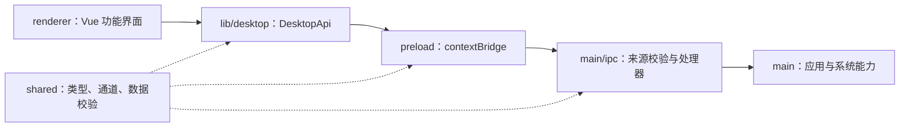
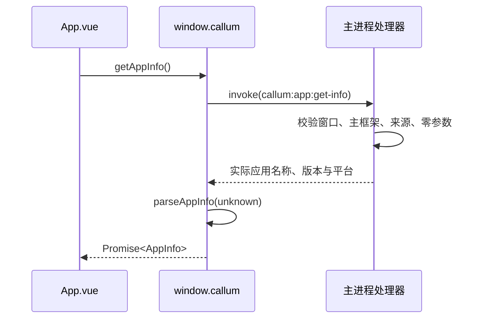

# 架构说明

## 目标与当前范围

脚手架建立桌面运行边界、功能组织方式和可重复的开发验证流程。目前包含应用窗口、新对话空状态、按工作区与对话组织的可收起侧栏、统一设置、主题偏好及应用信息读取。已确认后续随客户端嵌入 Callum Go 服务，由主进程通过 stdio 接入；当前尚未实现服务进程管理、会话读写、Agent、业务数据库接入和发布安装包。

## 进程与依赖方向



| 区域       | 负责                                                 | 不承担                                |
| ---------- | ---------------------------------------------------- | ------------------------------------- |
| `main`     | 应用装配、窗口、受限资源协议、系统能力和后续后端适配 | Vue 组件、界面状态                    |
| `preload`  | 将固定方法映射为固定 IPC 请求，校验返回数据          | 通用消息代理、业务编排                |
| `renderer` | 页面、导航、交互、主题和展示状态                     | 文件系统、命令执行、Electron 特权 API |
| `shared`   | 跨进程契约、通道常量和环境无关校验                   | Node.js、Electron、Vue 及具体进程实现 |

`main` 与 `renderer` 的 TypeScript 环境分开；界面环境不默认提供 Node.js 类型。ESLint 拒绝渲染进程导入 Node.js/Electron，也拒绝进程间直接导入实现代码。`@/` 仅指向界面目录，`@shared/` 指向公共契约。

目录按现有职责划分，不提前建立后端客户端、仓储、全局状态容器或依赖注入框架。新增模块时先确定其真实职责和资源所有权，再选择具体结构。

## 启动与关闭

1. `main/index.ts` 调用应用装配入口，集中处理启动失败。
2. `main/application.ts` 注册应用协议，在 Electron 就绪前同步准备用户数据目录及会话缓存路径，再等待就绪。此处不使用异步文件操作，避免提前触发 `ready` 后才设置路径。
3. 注册资源处理器和 IPC，配置默认拒绝的页面权限策略。
4. 创建窗口并立即记录所属窗口，再开始载入页面，保证页面启动期间的 IPC 可以验证所属关系。
5. 页面载入完成后显示窗口；载入失败时销毁窗口，启动错误由入口处理。用户在载入期间主动关闭窗口不视为启动故障。
6. 关闭窗口时释放对应引用；macOS 应用激活时可重新创建窗口，其他平台关闭全部窗口后退出。
7. 应用退出时撤销应用级 IPC 和资源协议处理器。未来增加连接、订阅或子进程时，应在同一应用生命周期下安排创建、取消、等待及释放。

窗口级事件随窗口销毁释放。主题系统监听器由 Vue 根组件持有，通过作用域销毁清理，不为每个页面重复注册。

## 一次真实的桌面调用



`DesktopApi` 是界面可用能力的完整清单，当前只有 `getAppInfo()`。不提供任意通道、任意路径读取或命令执行能力。preload 只导出业务方法，界面通过 `lib/desktop.ts` 获取桥接对象，不在浏览器环境伪造结果。

## 增加功能的路径

### 界面功能

1. 页面、功能组件和相关状态放入 `renderer/features/<功能>/`。
2. 真正跨功能复用的界面放入 `components/`，shadcn-vue 源码放入 `components/ui/`。
3. 在 `app/` 接入页面装配。当前新对话与设置两个页面通过根组件管理导航；设置容器装配外观分类，业务路由复杂后再引入路由器。
4. 功能内状态优先留在其拥有者中；出现跨页面共享需求时再引入相应状态管理。

侧栏的 `AppSidebar.vue` 负责内容导航，`AppShell.vue` 负责窗口标题区、侧栏开合和主内容容器。工作区分组用于工作区及其所属会话，对话分组用于未绑定工作区的会话；当前尚无列表数据，展示空状态。新对话页面不伪造会话或执行发送，添加工作区与发送入口明确不可用。

所有配置集中到设置页面，当前仅装配可用的外观分类。外观上下文仍由根组件持有，切换页面不会重置主题或重复创建系统主题监听。配置类别增加时在设置容器内扩展，不另加主侧栏入口。

### 桌面能力

1. 在 `shared/` 定义输入输出类型、运行时校验及必要的通道常量。
2. 在主进程相应模块实现能力，由 `main/ipc/` 校验来源、参数及操作范围后调用。
3. 在 preload 增加固定方法，并同步 `DesktopApi`。不要让调用方传入通道名称。
4. 界面通过桌面 API 使用能力，处理等待、失败、取消和用户反馈。
5. 为权限边界、无效输入及资源清理补充测试，验证实际调用链。

### Callum 后端

本机服务端源码位于 `/Users/xiaoyu/www/go/works/callum`。以下是 2026-11-04 对当前工作区的只读了解，服务端仍在修改，接入前需重新核对其 README、`docs/jsonrpc.md`、程序入口及协议实现。此路径仅供开发时查阅，不写入运行时配置，不从该仓库复制现有数据或凭据。

已核实的接入基础：

- 入口为 `cmd/callum/main.go`，服务使用 stdio JSON-RPC 2.0，每行一个完整 UTF-8 JSON 对象；stdout 只用于协议，结构化日志写入 stderr。
- 启动通知为 `system.ready`，包含 `protocol_version` 与通信限制；支持 `system.info` 查询及 `system.shutdown` 正常关闭。当前协议版本为 `1`，这是观察值，不作为客户端默认兼容承诺。
- 请求响应按 `id` 关联；服务端通知使用 `method` 区分事件。不能把子进程 stdout 的每个数据块直接当作一个完整 JSON 消息。
- 当前请求上限 1 MiB、响应上限 8 MiB，输出队列 64 条，写入或排队阻塞超过 5 秒会中断连接。适配层需要按字节限流、持续消费输出，并在握手前后都保留本地缓冲上限。
- 业务服务、数据库、实例锁、任务调度、模型 HTTP 调用和审批由 Go Runtime 持有。Electron 不直接读写服务端 SQLite，不复制模型或审批业务规则。
- `--data-dir` 支持显式数据目录；开发构建默认寻找 Go 项目目录，发布构建默认采用用户目录。嵌入运行时应传入独立的绝对数据路径，避免依赖子进程工作目录。
- `conversation.send` 首次提问创建会话。`message.delta` 追加增量，`message.updated` 替换完整消息；会话、执行及步骤事件可能交错，须按对应标识归属。
- 独立进程通过 `app.Run` 持有运行时；stdin EOF 或 `system.shutdown` 结束连接后，会取消、等待相关任务并关闭运行时资源。恢复中断状态不等于自动重试操作。

后续实施方向：

```text
Vue 功能界面
  → 固定的 DesktopApi
  → preload / Electron IPC
  → 主进程中的 Callum 适配模块
  → 随客户端分发的 Go 子进程（stdio JSON-RPC）
```

主进程负责定位对应系统及架构的二进制、无 Shell 启动子进程、就绪超时、请求关联、有界事件转发、日志分流和关闭。服务资源按应用级别持有，不为每个窗口启动一个服务；macOS 关闭窗口后保留应用时，不能意外关闭服务 stdin。

应用退出时应先停止受理，通过已确认协议请求服务关闭，持续排空输出并等待进程退出；超时兜底及异常退出策略在接入时明确。断连后将未确定结果标为未知，不直接重发可能有副作用的操作。工具审批快照、权限及执行结果仍由后端契约决定。

当前 macOS arm64 Go 程序已放入 `resources/backend/darwin-arm64/callum`，资源布局及后续复制映射见 [后台程序资源约定](../resources/backend/README.md)。目前尚未配置安装包打包工具或资源复制，不能把放入资源目录描述为已完成打包。

发布时需按目标平台选择程序，复制到 ASAR 外的应用资源目录，并由主进程基于 `process.resourcesPath` 解析实际路径；开发时使用明确配置的资源路径，不要求最终用户安装 Go。发布格式、二进制版本配对、签名和协议兼容检查在实施发布时确定。目前不创建空的服务适配层或未经联调的 DTO。

## 资源与状态所有权

| 资源或状态             | 持有者           | 释放或更新时机                         |
| ---------------------- | ---------------- | -------------------------------------- |
| 主窗口引用             | 应用装配         | 窗口关闭时清空                         |
| 资源协议与 IPC 注册    | 应用装配         | 应用退出时撤销                         |
| 页面导航               | Vue 根组件       | 当前窗口关闭时销毁                     |
| 主题偏好、系统主题监听 | 外观上下文       | 偏好按设备保存，监听随根作用域释放     |
| 界面局部状态           | 对应功能或组件   | 随所属功能生命周期清理                 |
| 未来后端连接及后台任务 | 明确的主进程模块 | 按应用级生命周期停止、取消、等待和关闭 |

跨进程不直接传递 `AbortSignal` 或 Electron 对象。未来需要远程取消时，使用已确认的请求标识与取消消息，将它们映射到各进程自己的取消机制。

## 运行安全

- 发布界面通过标准、安全的 `callum://app/` 协议加载。资源映射限制在 `out/renderer` 内，拒绝非预期主机、凭据、端口及编码后的路径逃逸。
- IPC 不能只比较 URL 的 `origin`：Node.js 对自定义协议可能返回相同的 `null`。当前显式校验协议、主机、端口及页面路径。
- preload 编译成独立的 CommonJS 文件 `index.cjs`，适用于开启沙箱的预加载环境。
- 开发服务器仅允许本机 HTTP 地址；开发 CSP 单独允许固定端口的热更新 WebSocket，发布 CSP 不继承该例外。
- `contextIsolation`、`sandbox` 和 `webSecurity` 开启，`nodeIntegration` 和 `webviewTag` 关闭；禁止新窗口及非预期页面导航。
- 界面只保存主题偏好，业务持久化和凭据存储方案尚未确定。测试必须使用独立用户目录。

## 构建与验证

electron-vite 统一协调三个进程的开发与生产构建。`out/` 仅包含构建产物，不作为源码修改。

- TypeScript：分别检查主进程/配置、Vue 界面和测试，防止环境类型互相污染。
- ESLint：检查代码及模块导入边界；Prettier 独立负责格式。
- 单元测试：使用 Node.js 26 的内置 TypeScript 支持与测试运行器，验证数据契约和安全策略。
- Electron 测试：运行真实构建，检查应用信息、Node.js 隔离、沙箱、CSP、主题保存及系统主题响应、侧栏和 macOS 激活。

运行命令见 [README](../README.md)。安装包、签名、自动更新和多平台发布流水线需在目标及分发方式确定后配置，不把普通构建描述为已完成发布。

## 技术参考

- [electron-vite](https://electron-vite.org/guide/)
- [Electron 进程模型](https://www.electronjs.org/docs/latest/tutorial/process-model)
- [Electron 安全建议](https://www.electronjs.org/docs/latest/tutorial/security)
- [Electron 自定义协议](https://www.electronjs.org/docs/latest/api/protocol)
- [shadcn-vue 的 Vite 接入](https://www.shadcn-vue.com/docs/installation/vite)
