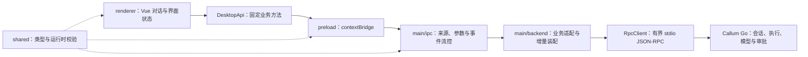

# 架构说明

## 目标与当前范围

客户端包含应用窗口、按工作区与独立对话组织的侧栏、统一设置、外观偏好及受限桌面通信。文本对话已经通过随附 Go 程序接入，支持历史读取、模型选择、流式回答、停止与工具审批。模型设置支持供应商与模型的新增、编辑、删除和模型启停；工作区管理、附件上传、编辑重发和发布安装包尚未接入。

## 进程与依赖方向

| 区域       | 负责                                              | 不承担                              |
| ---------- | ------------------------------------------------- | ----------------------------------- |
| `main`     | 生命周期、窗口、资源协议、Go 进程、通信及业务转换 | Vue 组件及模型 SDK                  |
| `preload`  | 固定 IPC 方法、返回数据校验、通知确认及取消订阅   | 通用 RPC 转发和业务编排             |
| `renderer` | 页面、导航、草稿、主题与对话展示                  | Node.js、文件系统、子进程或厂商协议 |
| `shared`   | 跨进程业务契约、通道和环境无关校验                | 任何具体运行进程的实现              |

TypeScript 环境分别管理，ESLint 检查进程导入边界。`@/` 指向界面，`@shared/` 指向共享契约。不引入路由、Pinia、客户端数据库或模型 SDK 来重复现有职责。

## 启动与关闭

1. `main/index.ts` 调用装配入口，集中处理应用启动失败。
2. `application.ts` 在 `ready` 前同步设置用户数据和会话缓存目录，再等待 Electron 就绪，避免设置路径时机的竞态。
3. 注册资源协议、固定 IPC 和默认拒绝的权限策略，创建应用级 `ChatService`。Go 服务启动失败作为对话错误反馈，外观设置仍可使用。
4. 创建窗口，先记录引用再载入页面；加载完成后显示。用户在加载中关闭窗口不视为启动失败。
5. macOS 关闭窗口清理对应引用与通知队列，Go 连接持续消费输出并保留执行。激活时重新创建窗口，界面通过查询恢复状态。
6. 应用 `before-quit` 停止受理业务请求，请求 `system.shutdown`，等待服务取消、完成清理并退出。协议关闭最多等待 3 秒，随后等待自然退出 3 秒、SIGTERM 2 秒、SIGKILL 2 秒；超时记录关闭失败。
7. `will-quit` 撤销 IPC、订阅与资源协议。服务关闭可重复调用，初始化失败同样释放已创建进程。

服务异常断开会拒绝所有待处理请求、提示结果未知，并通过有界终止结束自有进程。不会自动重新执行写请求。恢复依靠重新打开应用后查询 Go 保存的状态，不等同于重新发送。

## 桌面 API 与状态

`DesktopApi` 包含应用信息、供应商与模型配置、模型与会话列表、会话详情、更早消息、发送、取消、审批决定和对话通知订阅。没有任意方法名、通道、命令或路径访问入口。主进程校验窗口、主框架、来源、参数数量、UUIDv7、文本长度和允许的决定；preload 再校验返回的业务数据。

`useConversations.ts` 由 Vue 根组件创建，通过注入共享给侧栏和对话页面。切换到设置不会销毁订阅或中断执行。每个窗口只持有一个通知订阅，销毁根作用域时取消；主题监听也由根作用域持有。

界面按会话、执行和消息 ID 更新状态，切换时使用选择标识丢弃迟到查询结果。加载快照期间合并完整消息事件，快照 revision 之后的事件才继续覆盖对应内容，防止旧通知覆盖新查询。新对话在首次发送前没有业务记录。

历史按每页 50 条读取，可以查看更早页面并返回最新消息；当前消息窗口最多 200 条及约 4 Mi 字符。浏览历史时不把其他页面的增量插入当前历史页。侧栏每页 50 条，单窗口最多 1000 条记录；草稿最多 100 份、每份 100000 个 JavaScript 字符，仅存窗口内存，刷新或关闭后不保留。

## Callum 后端

服务端源码位于 `/Users/xiaoyu/www/go/works/callum`，仅供开发时核对协议，不写入运行配置。本次依据其当前 `docs/jsonrpc.md` 和实现，并使用客户端资源目录中的实际程序完成联调。服务端仍在修改，后续调整接口前须重新核对工作区和契约。

### 程序与数据路径

- 开发与本地构建预览从应用构建位置解析仓库 `resources/backend/darwin-arm64/callum`，不依赖当前工作目录。
- 发布程序从 `process.resourcesPath/backend/darwin-arm64/callum` 解析，程序须位于 ASAR 外并保留执行权限。
- 当前只有 macOS Apple Silicon 程序。安装包打包工具、资源复制、签名和其他平台产物尚未配置或验证，放入仓库不代表已经进入安装包。详见[资源约定](../resources/backend/README.md)。
- `backend/data-directory.ts` 统一计算 Go 数据目录：默认由系统家目录得到 `~/.callum` 的绝对路径，开发、预览和发布一致。显式设置 `CALLUM_USER_DATA_DIR` 时优先使用 `<隔离用户数据目录>/backend`，测试不会访问真实家目录。`ChatService` 接收已确定的绝对数据路径，不再自行附加 `backend`，通过 `--data-dir` 传给服务。
- 新服务数据目录权限为 `0700`，不擅自改变已有权限。数据库、配置、模型凭据及实例锁均由 Go 管理，Electron 不直接读取或修改 SQLite。Electron 缓存和外观偏好仍使用原系统应用数据目录。
- 原 `userData/backend` 保留，不自动迁移、合并或删除；目标 `~/.callum` 存在时读取其中的数据，不覆盖为旧目录内容。已有数据格式的校验和升级由 Go 处理，不能让两个服务同时占用同一目录。
- 默认新目录没有模型，用户通过“设置 → 模型”配置供应商和模型，保存后可直接用于对话。不会复制源码仓库的日常数据或凭据；Go 的数据目录实例锁防止多个服务同时使用同一数据库。

### 模型配置

`main/backend/model-catalog.ts` 复用 `ChatService` 的唯一 RPC 连接，通过固定的供应商和模型接口保存配置，不创建额外进程或直接访问数据库。IPC 分别暴露查询、供应商保存/删除、模型保存/删除及模型启停，不接受任意方法名。

- `shared/models.ts` 校验配置字段、UUIDv7、长度、HTTP/HTTPS 根地址和明确的密钥操作；拒绝 URL 内的账号密码、查询参数、片段及未知输入字段。服务类型选项集中定义在 `PROVIDER_SERVICES`，类型由选项推导；当前仅提供 Chat Completions（`chatcompletions`）。供应商新增默认选中，编辑回填已保存的类型；主进程校验后按所选协议提交。未知已有类型不会被静默改为默认值。后续扩展选项时必须同时落实 Go 服务对应的协议支持。
- 配置写入互斥，拒绝并发重复操作；失败后释放写入状态。API 返回成功并核对记录标识后才显示已保存；列表加载失败与写入失败分开提示，不自动重发写请求。
- `model.update` 是完整替换。适配层保存基础字段前读取最新模型，保留后端已有的 `context_window`、`max_output_tokens`、`capabilities`、`model_type` 和 `reasoning_levels`，避免未编辑的元数据被清空。这些高级字段当前没有 UI 编辑入口。
- 供应商编辑留空密钥时不发送 `api_key` 字段；只有明确替换或清除时才传入值。列表只返回 `hasApiKey` 状态，客户端不请求或回显已有密钥。
- 凭据存储仍由 Go 服务持有。现有服务把 API Key 以明文保存在本地 SQLite，尚未接入系统钥匙串；本次按确认范围沿用该机制，没有宣称加密存储。客户端不把密钥写入 localStorage、sessionStorage、查询快照或日志；关闭编辑弹窗时销毁表单的临时凭据状态。
- 配置页由 `ModelSettings.vue` 持有加载与写入状态，编辑表单按弹窗生命周期创建和销毁。弹窗使用现有 reka-ui 的焦点约束、Esc 关闭与焦点恢复；写入期间防止重复提交或关闭。
- 设置保存后向根组件同步可用模型，返回对话时重新查询。对话状态以请求代次避免迟到的旧概览覆盖配置更新，不重建会话订阅或停止正在进行的执行。右下角选择器与发送／停止按钮相邻，无模型时直接进入模型设置，不保留常驻刷新按钮。
- 没有新增依赖、模型 SDK、厂商预设或自动模型发现。外部网络请求仍由 Go 在实际发送对话时执行。

### stdio 传输

`rpc-client.ts` 无 Shell 启动固定程序，stdout 只作协议通道。持续消费 stderr，当前不转发诊断原文，避免对话与凭据进入客户端日志；客户端仅在应用边界记录脱敏故障。没有新增文件日志。

- 逐行 UTF-8 JSON-RPC 2.0，以字符串请求 ID 关联响应；使用有界字节缓冲处理分片、粘包和 UTF-8 边界，拒绝损坏数据。
- 就绪通知验证服务名、协议版本 `1` 和当前通信上限；启动等待 15 秒。
- 请求最多 1 MiB、响应帧最多 8 MiB；最多 64 个待处理请求，stdin 写队列最多约 2 MiB。
- 单次 RPC 等待 15 秒，发送响应表示受理，回答完成另由执行事件决定；不会让 RPC 超时承担整个模型执行时间。
- 超时后受理结果未知，关闭连接并提示核对历史，禁止自动重试写操作。

### 业务适配与事件

`protocol-mapper.ts` 将 Go 字段转换为界面需要的类型，不传递厂商配置。`chat-service.ts` 负责调用固定方法、拼接文本增量、处理归属并构造一致快照：

- `conversation.send` 首次提问创建会话；历史上下文、模型调用和标题均由 Go 管理。
- `message.delta` 追加到指定消息和内容块，`message.updated` 使用完整消息替换本地内容，工具调用前的中间文本可以被清空。
- 活动消息在主进程持有，界面关闭后仍消费流；重新打开窗口可读取尚未完全落库的回答。终态时释放对应活动缓存。
- 完整消息通知按约 40ms 合并；快照协调记录最多 512 条、16 MiB，超出恢复窗口时要求重新加载，不返回不一致快照。
- `ChatEventDelivery` 每次向窗口发送一条通知，preload 在处理后通过固定内部通道确认。等待期间按实体合并最新快照，队列最多 128 个实体、16 MiB；积压超限时提示重新查询。确认和订阅通道同样校验来源，不暴露给业务界面。
- 正常结束、失败、取消、重启后的中断与连接断开分别处理。`persisted:false` 保留落库失败提示，不把内存中的终态当作已安全保存。
- 工具审批展示 Go 生成的完整操作快照，客户端只提交审批 ID 与决定，不修改目标、不绕过后端权限。审批通过后继续等待执行终态。
- 不显示估算 usage，也不生成虚假用量；原始 usage 由 Go 保存。本次 UI 不提供步骤数据或用量查询。

## 资源与状态所有权

| 资源或状态                         | 持有者                      | 释放或更新时机                         |
| ---------------------------------- | --------------------------- | -------------------------------------- |
| 主窗口引用                         | 应用装配                    | 窗口关闭                               |
| 资源协议、IPC 与服务订阅           | 应用装配                    | 应用退出                               |
| Go 进程、请求与输出缓冲            | `ChatService` / `RpcClient` | 初始化失败、异常断连或应用退出         |
| 窗口通知和确认队列                 | IPC 接入层                  | 页面重载、取消订阅、窗口销毁或应用退出 |
| 会话、消息、模型配置、审批、实例锁 | Go Runtime                  | 按 Go 的持久化及关闭契约管理           |
| 当前页面、消息窗口和草稿           | Vue 根组件                  | 当前窗口关闭或页面刷新                 |
| 主题偏好及系统主题监听             | 外观上下文                  | 偏好按设备保存，监听随根作用域释放     |

取消订阅、切换页面或关闭 macOS 窗口都不等于取消执行；停止生成通过后端 `run.cancel` 发送，确认取消受理后仍等待最终状态。

## 运行安全

- 发布页面使用 `callum://app/`，资源映射限制在 `out/renderer`，拒绝路径逃逸、其他主机、凭据及端口。
- IPC 比较协议、主机、端口及页面路径，不能只比较自定义协议的 `null` origin。
- preload 输出独立 CommonJS 文件 `index.cjs`，适配沙箱。
- 开启 `contextIsolation`、`sandbox`、`webSecurity`，关闭 `nodeIntegration` 和 `webviewTag`；拒绝新窗口、非预期导航和页面权限。
- 发布 CSP 禁止界面网络连接；开发模式单独允许固定本机端口的热更新 WebSocket。
- 模型文本和审批快照按外部数据以文本展示，不执行 HTML 或其中的命令。主题偏好可存页面存储，凭据和对话不存 localStorage。

## 构建与验证

electron-vite 构建主进程、preload 与界面到 `out/`。普通构建不生成安装包。

- TypeScript 分别检查主进程、界面和测试；ESLint 检查规范与跨进程导入，Prettier 检查格式。
- Node 测试覆盖默认家目录与显式隔离路径、旧目录保留、来源边界、契约、字节分片、并发请求、超时、断连、帧上限与窗口流控。
- 集成测试运行实际 Go 程序，使用独立临时数据目录和本机 HTTP 端点，验证供应商/模型配置、密钥保留/替换/清除、元数据保留，以及流式、并行隔离、取消、失败、批准/拒绝/取消审批、应用退出和历史恢复。受控响应形状参考 Go 的 `internal/app/agent_test.go`，没有调用真实模型厂商。
- Electron 测试使用真实构建，检查隔离、CSP、主题、导航、输入、右侧模型选择、配置后发送、配置表单与弹窗键盘行为、对话历史、审批、取消、窗口缩放及 macOS 生命周期。

运行命令见 [README](../README.md)。真实模型兼容性、安装包资源复制、签名和其他平台仍需对应环境验证。

## 技术参考

- [electron-vite](https://electron-vite.org/guide/)
- [Electron 进程模型](https://www.electronjs.org/docs/latest/tutorial/process-model)
- [Electron 安全建议](https://www.electronjs.org/docs/latest/tutorial/security)
- [Electron 自定义协议](https://www.electronjs.org/docs/latest/api/protocol)
- [shadcn-vue 的 Vite 接入](https://www.shadcn-vue.com/docs/installation/vite)
